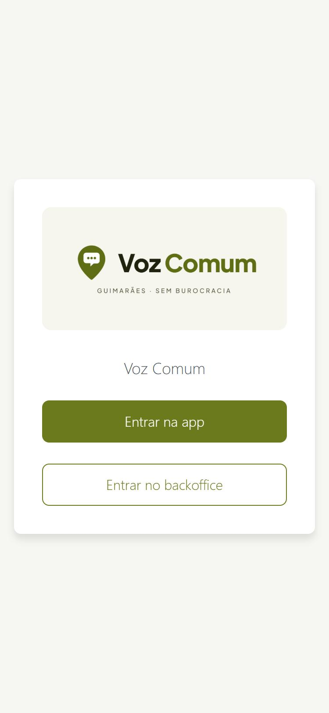
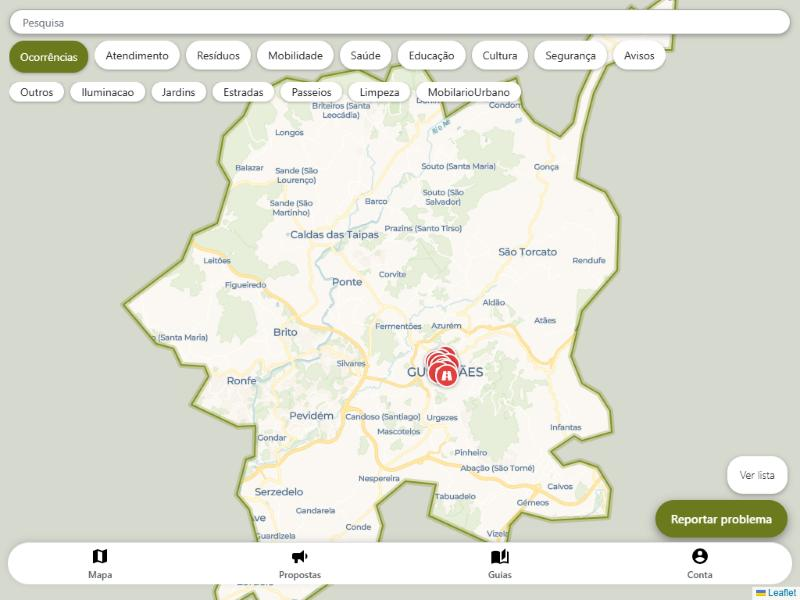
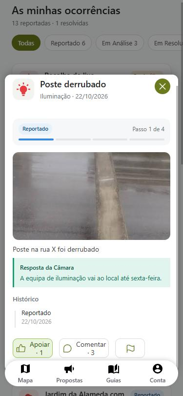
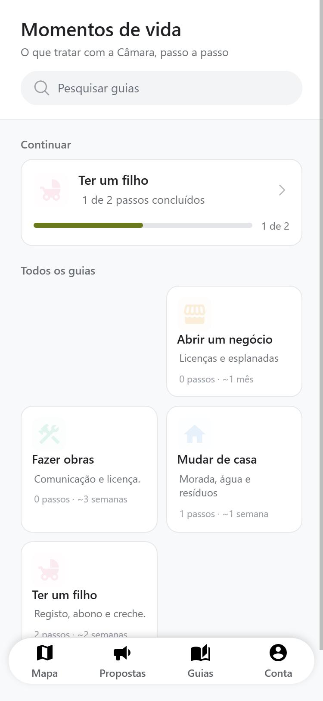
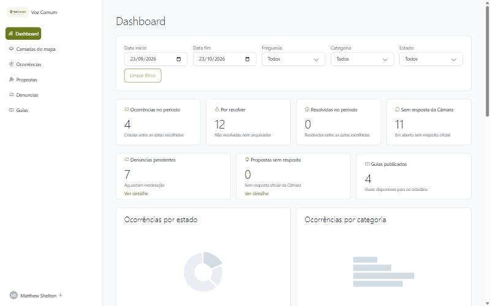
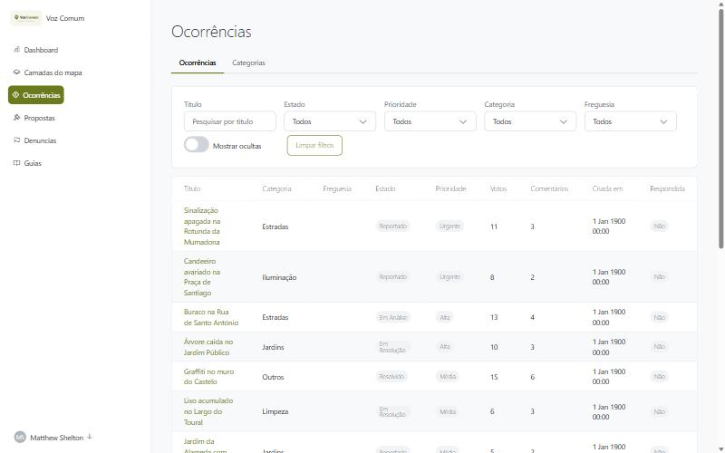
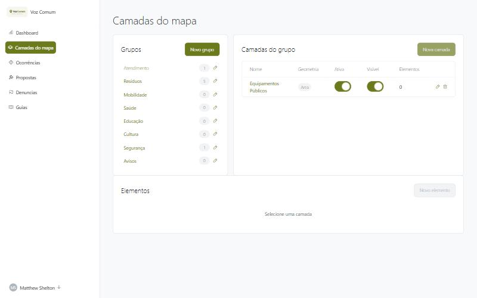

# Voz Comum

**Falar com a Câmara sem burocracia.**
Projeto para o **Hack4Guimarães**, Desafio 4: *"Falar com a Câmara sem burocracia"*.

A Voz Comum é o ponto único onde o cidadão de Guimarães fala com a Câmara Municipal. Vê no mapa o que o município oferece, reporta problemas no espaço público, acompanha o que acontece a cada um, apoia e comenta as ocorrências e propostas de outros cidadãos e percebe, passo a passo e em linguagem simples, o que tem de tratar em cada momento da vida. Do outro lado, a Câmara tem um backoffice onde responde, define prioridades, modera conteúdo e gere o mapa e os guias sem precisar de apoio técnico.

> 🔗 **Demonstração:** https://personal-u6frr0hs-dev.outsystems.app/VozComum
>
> Na página de entrada há dois botões de demonstração:
> - **Entrar na app**: experiência do cidadão (conta de demonstração com o papel *Cidadão*).
> - **Entrar no backoffice**: experiência da Câmara (conta de demonstração com o papel *Operador Municipal*). Nesta versão pública, o operador pode navegar em todo o backoffice, mas as gravações estão reservadas ao Administrador e mostram um aviso de demonstração.

---

## Índice
- [O problema](#o-problema)
- [A solução](#a-solução)
- [Funcionalidades](#funcionalidades)
- [Capturas de ecrã](#capturas-de-ecrã)
- [Tecnologia e arquitetura](#tecnologia-e-arquitetura)
- [Estrutura do repositório](#estrutura-do-repositório)
- [Como abrir o projeto](#como-abrir-o-projeto)
- [Decisões e limitações do MVP](#decisões-e-limitações-do-mvp)
- [Próximos passos](#próximos-passos)

---

## O problema
A informação municipal é pública, mas está dispersa. Saber que licença pedir, a quem reportar um buraco na estrada ou em que ponto está um pedido obriga muitas vezes a ir ao balcão. Quem tem pouca literacia digital fica ainda mais longe.

## A solução
Uma única aplicação, pensada primeiro para o telemóvel, com dois lados:

| Para o cidadão | Para a Câmara |
|---|---|
| Um só lugar, em linguagem simples | Um canal de ida e volta |
| Mapa do concelho com serviços e ocorrências | Dashboard com indicadores e filtros |
| Reportar um problema em 4 passos | Triagem de ocorrências: estado, prioridade, resposta oficial |
| Apoiar e comentar ocorrências e propostas | Moderação de denúncias |
| Guias de "momentos de vida" com checklist | Gestão das camadas do mapa e dos guias |

**Hipóteses que o MVP quer validar:**
1. Os cidadãos preferem uma aplicação única a várias soluções isoladas.
2. Os cidadãos sinalizam problemas e apoiam os dos outros quando veem resposta da Câmara.
3. A Câmara consegue manter guias, camadas do mapa e respostas sem apoio técnico.
4. Guias em linguagem simples reduzem a necessidade de ir ao balcão.

---

## Funcionalidades

### App do cidadão (mobile-first)
- **Mapa interativo de Guimarães:** o mapa fica preso ao contorno do concelho, com máscara e limites, e tem camadas dinâmicas geridas pela Câmara (serviços, resíduos, mobilidade…) e a camada de ocorrências. Tocar num elemento abre uma gaveta de detalhe.
- **Reportar ocorrência:** um assistente em 4 passos (categoria → local no mapa → descrição → foto opcional), com aviso para não fotografar rostos nem matrículas.
- **As minhas ocorrências:** filtros por estado com contadores e cartões com barra de progresso (Reportado → Em análise → Em resolução → Resolvido).
- **Gaveta de detalhe:** estado e progresso, foto, descrição, resposta oficial da Câmara, linha temporal das mudanças de estado, e as ações **Apoiar**, **Comentar** e **Denunciar**.
- **Propostas:** criar, votar, comentar e ver a resposta oficial.
- **Momentos de vida:** guias passo a passo (por exemplo, "Ter um filho"), com checklist e progresso guardado.
- **Conta:** perfil e preferências.

### Backoffice da Câmara (web)
- **Dashboard:** filtros por período, freguesia, categoria e estado; indicadores (ocorrências no período, por resolver, resolvidas, sem resposta, denúncias pendentes, propostas sem resposta, guias publicados); gráficos por estado, categoria, tempo e freguesia; tabelas "Precisa de atenção" e "Mais apoiadas".
- **Ocorrências:** tabela com filtros e um detalhe onde se muda o estado (com nota e registo no histórico), a prioridade e a resposta oficial, e onde se oculta conteúdo. Inclui a gestão das categorias.
- **Camadas do mapa:** grupos → camadas → elementos num só ecrã, com formulários em popup.
- **Propostas, denúncias e guias:** gestão e moderação.

### Transversal
- **Mecanismos genéricos:** votos, comentários, denúncias e histórico de estados foram feitos uma só vez e aplicam-se a vários alvos (ocorrência, proposta, comentário) através de um `TipoAlvo`.
- **Preparada para vários municípios:** todos os dados de negócio pertencem a um município.
- **Nada se apaga:** ocorrências e propostas são ocultadas (soft delete), para manter o histórico e a integridade dos votos e comentários.
- **Segurança no servidor:** os papéis são validados nas server actions, e não apenas escondendo botões.

---

## Capturas de ecrã

| Entrada | Mapa | As minhas ocorrências | Detalhe da ocorrência | Guias |
|---|---|---|---|---|
|  |  |  |  |  |

| Dashboard | Ocorrências | Camadas do mapa |
|---|---|---|
|  |  |  |

---

## Tecnologia e arquitetura
- **Plataforma:** [OutSystems Developer Cloud (ODC)](https://www.outsystems.com/developer-cloud/), numa única aplicação **Reactive Web** com dois layouts: mobile-first para o cidadão e desktop com menu lateral para a Câmara.
- **Mapa:** componente **MapFlow\Leaflet** (Forge), com tiles **CARTO Voyager** e uma máscara do concelho desenhada em JavaScript sobre o mapa ([`src/js/mapa-mascara.js`](src/js/mapa-mascara.js)).
- **UI:** OutSystems UI, com CSS próprio só na app do cidadão ([`src/css/`](src/css)).
- **Dados:** 28 entidades (19 normais e 9 estáticas). Ver o [modelo de dados](docs/modelo-dados.md).
- **Lógica:** server actions por módulo, chamadas pelos ecrãs. Ver a [arquitetura](docs/arquitetura.md).

O desenvolvimento usou o **ODC Studio** e o **Mentor** (o assistente de IA da OutSystems), com apoio do **Claude** (Anthropic) através do servidor MCP da OutSystems para análise, planeamento, revisão de interface e testes no browser.

---

## Estrutura do repositório
```
├── README.md                    este ficheiro
├── app/                         modelo da aplicação ODC (.oml), ver app/README.md
├── docs/
│   ├── requisitos-voz-comum.docx  documento de requisitos original
│   ├── arquitetura.md             ecrãs, lógica, papéis e segurança
│   ├── modelo-dados.md            entidades e relações (diagrama Mermaid)
│   └── screenshots/               capturas da app e do backoffice
└── src/
    ├── css/                     CSS custom publicado (tema e ecrãs da app do cidadão)
    └── js/                      JavaScript usado no mapa e na gaveta
```

> **Nota sobre o código-fonte:** uma aplicação ODC é desenvolvida visualmente, e o seu "código-fonte" é o modelo da aplicação (ficheiro `.oml`), que abre no ODC Studio. Os ficheiros em `src/` são extratos do CSS e do JavaScript escritos à mão, para facilitar a leitura sem o Studio.

## Como abrir o projeto
1. **Ver a funcionar:** abrir o [link da demonstração](https://personal-u6frr0hs-dev.outsystems.app/VozComum) e entrar com um dos botões.
2. **Ver o modelo:** com o [ODC Studio](https://www.outsystems.com/downloads/), abrir o ficheiro `.oml` em [`app/`](app) (é preciso uma conta ODC, por exemplo a Personal Edition gratuita).

---

## Decisões e limitações do MVP
- **Processos administrativos reais** (acompanhar um pedido de licença, por exemplo) dependem de dados que não são públicos. Ficaram de fora, e o estado das ocorrências cobre a mesma necessidade para o espaço público.
- **A prioridade de uma ocorrência é decidida pela Câmara.** Os votos servem para ordenar e mostrar relevância, mas não a definem sozinhos.
- **Os dados das camadas e dos guias** foram preparados à mão para a demonstração.
- **Fora do MVP** (previsto no modelo de dados): modo ajudante entre contas, notificações, deteção automática de duplicados, Chave Móvel Digital e dados abertos importados em massa.

## Próximos passos
- Modo ajudante (um familiar ou um funcionário ao balcão ajuda o cidadão a seguir um guia).
- Leitura em voz alta, texto grande e alto contraste em toda a app.
- Versão imprimível dos guias, com código QR.
- Importação de dados abertos do município para as camadas do mapa.
- Autenticação com Chave Móvel Digital.

---

**Autor:** João Carvalho, Hack4Guimarães 2026
