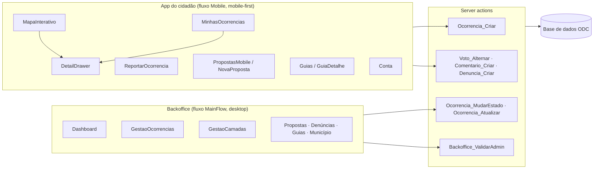

# Arquitetura

A Voz Comum é **uma única aplicação ODC Reactive Web**, com três fluxos de interface e a lógica de negócio em server actions. Uma futura app móvel nativa ou uma integração por API pode reutilizar a mesma lógica e só muda a interface.

## Fluxos de interface
| Fluxo | Público | Ecrãs |
|---|---|---|
| **Mobile** | Cidadão | `MapaInterativo`, `ReportarOcorrencia`, `MinhasOcorrencias`, `PropostasMobile`, `NovaProposta`, `Guias`, `GuiaDetalhe`, `Conta` |
| **MainFlow** | Operador Municipal, Administrador | `Dashboard`, `GestaoOcorrencias`, `GestaoCamadas`, e ecrãs de gestão para propostas, denúncias, comentários, momentos de vida e passos, município, freguesias e utilizadores |
| **Common** | Todos | `Login`, `InvalidPermissions`, recuperação de password |

**Blocos reutilizáveis:**
- `DetailDrawer`: a gaveta de detalhe, partilhada pelo mapa e pela lista.
- `BotaoVoto`, `DenunciarForm`, `FioComentarios`: os mecanismos genéricos de participação.
- `BottomBar`: a navegação do cidadão.

## Papéis
| Papel | Pode |
|---|---|
| **Cidadão** | Ver o mapa, as ocorrências, as propostas e os guias; reportar ocorrências; criar propostas; votar, comentar e denunciar; seguir os guias. |
| **Operador Municipal** | Tudo o que o cidadão faz, mais o backoffice: triagem de ocorrências, respostas oficiais, moderação, camadas e guias do seu município. |
| **Administrador** | Tudo, mais a configuração (município, freguesias, utilizadores). |

## Lógica principal (server actions)
| Ação | O que faz |
|---|---|
| `Ocorrencia_Criar` | Cria a ocorrência com o município do utilizador, no estado *Reportado*, e regista a primeira entrada no `HistoricoEstado`. |
| `Voto_Alternar` | Cria ou retira o voto (um por utilizador e por alvo) e atualiza o `NumVotos` na mesma operação. Recusa votos em alvos arquivados ou encerrados. |
| `Comentario_Criar` | Comenta ou responde (só a um nível). Marca o comentário como oficial quando o autor é da Câmara e atualiza o `NumComentarios`. |
| `Denuncia_Criar` | Regista uma denúncia por utilizador e por conteúdo, no estado *Pendente*. |
| `Ocorrencia_MudarEstado` | Muda o estado e grava um `HistoricoEstado` (estado anterior, novo, quem, quando e nota). Arquivar exige nota. |
| `Ocorrencia_Atualizar` / `Ocorrencia_AlternarOculta` | Prioridade e resposta oficial; ocultar ou mostrar a ocorrência (soft delete). |
| `MarcarPassoConcluido` | Guarda o progresso do cidadão num guia. |
| `Backoffice_ValidarAdmin` | Proteção da versão pública de demonstração (ver abaixo). |

## Regras de negócio
- Todos os dados de negócio pertencem a um **município**, e as consultas filtram pelo município do utilizador.
- Há **um voto por utilizador e por alvo**, e votar outra vez retira o voto. A **prioridade** é definida pela Câmara e não pelos votos.
- **Ocorrências e propostas não se apagam**, só se ocultam. Os contadores não contam conteúdo oculto.
- **Cada mudança de estado** fica registada no histórico, e é esse registo que alimenta a linha temporal que o cidadão vê.
- **Os comentários têm respostas só a um nível.** Os comentários de operadores aparecem como oficiais.

## Segurança
- **Os papéis são validados no servidor**, nas server actions, e não apenas nos ecrãs.
- **Versão pública de demonstração:** todas as server actions de escrita usadas pelo backoffice (65 ao todo) começam por `Backoffice_ValidarAdmin`. Esta ação lança a exceção `DemoApenasAdministrador` quando o utilizador não é Administrador. Assim, o júri pode explorar o backoffice com a conta de Operador sem alterar dados. As ações da app do cidadão não são afetadas.
- **Dados pessoais:** o email nunca é público, e o formulário de ocorrência avisa para não fotografar rostos nem matrículas.

## Mapa
- Usa o componente **MapFlow\Leaflet** da Forge, com tiles **CARTO Voyager** (`https://{s}.basemaps.cartocdn.com/rastertiles/voyager/{z}/{x}/{y}.png`).
- **A máscara do concelho** é desenhada uma única vez, no evento `OnMapRender`: um polígono do mundo com um buraco com a forma do concelho, mais uma borda com halo, com `setMaxBounds`, `setMinZoom` e `maxBoundsViscosity`. O código está em [`../src/js/mapa-mascara.js`](../src/js/mapa-mascara.js).
- **As camadas são dinâmicas** (`GrupoCamada` → `TipoCamada` → `MapItem`) e a Câmara gere-as no ecrã *Camadas do mapa*.
