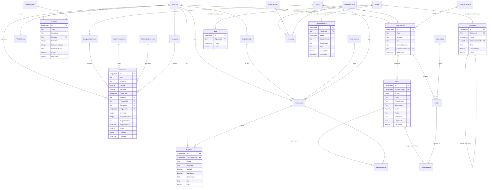

# Modelo de dados

28 entidades: 19 normais e 9 estáticas. Lidas do modelo publicado da aplicação ODC.

**Convenções:**
- Nomes em português sem acentos.
- Identificadores `<Entidade>Id`.
- `MunicipioId` em todas as entidades de negócio, para a app estar preparada para vários municípios.
- Ocorrências e propostas nunca se apagam: têm `Oculta = True`.

## Diagrama

## Entidades

### Município, utilizadores e mapa
| Entidade | Atributos principais | Notas |
|---|---|---|
| **Municipio** | Nome, Distrito, Pais, Logo, CorPrincipal, CentroLatitude/Longitude, ZoomInicial, LimiteGeoJson, Ativo | É a raiz dos dados. O `LimiteGeoJson` desenha a máscara do concelho. |
| **Freguesia** | Nome, MunicipioId, Ativo | Usada para filtrar e para estatísticas. |
| **PerfilUtilizador** | Nome, MunicipioId, FreguesiaId, TextoGrande, AltoContraste, LeituraEmVozAlta, ModoSimples, Idioma, ConsentimentoRgpdEm | Há um por utilizador. Os papéis ficam nos roles do ODC. |
| **GrupoCamada** | Nome, Cor, Ordem, MunicipioId | Agrupa as camadas no mapa (Resíduos, Mobilidade…). |
| **TipoCamada** | Nome, Descricao, GrupoCamadaId, TipoGeometriaId, IconeId, CorHex, Ativa, VisivelPorDefeito, Ordem | É criada pela Câmara, por isso não é estática. |
| **MapItem** | Nome, Descricao, GeoJson, Latitude, Longitude, Informacao, Url, Ativo | Um elemento de uma camada (ponto, linha ou área). |
| **Icone** | Nome, Caminho, Etiquetas, Ativo | Biblioteca de ícones partilhada. |

### Participação
| Entidade | Atributos principais | Notas |
|---|---|---|
| **Ocorrencia** | Titulo, Descricao, Latitude, Longitude, FotoBinario, Categoria, Estado, Prioridade, Freguesia, NumVotos, NumComentarios, RespostaOficial, Oculta | Os contadores estão guardados, para ordenar sem agregar. |
| **Proposta** | Titulo, Descricao, Estado, NumVotos, NumComentarios, RespostaOficial, Oculta | A resposta oficial é pública. |
| **Voto** | TipoAlvoId, AlvoId, UserId | Genérico. Há um voto por utilizador e por alvo, e votar outra vez retira o voto. |
| **Comentario** | TipoAlvoId, AlvoId, ComentarioPaiId, Texto, OficialCamara, Oculto | Genérico, com respostas só a um nível. |
| **Denuncia** | TipoAlvoId, AlvoId, MotivoId, Descricao, EstadoDenunciaId, Decisao, ResolvidoPor | É a fila de moderação. |
| **HistoricoEstado** | TipoAlvoId, AlvoId, EstadoAnterior, EstadoNovo, Nota, AlteradoPor, AlteradoEm | Alimenta a linha temporal que o cidadão vê. |

### Momentos de vida
| Entidade | Atributos principais | Notas |
|---|---|---|
| **MomentoVida** | Titulo, Resumo, IconeId, Cor, DuracaoEstimada, EstadoPublicacaoId, ValidadoPor/Em | Só os guias publicados aparecem ao cidadão. |
| **Passo** | Ordem, Titulo, TextoSimples, Documentos, Custo, Prazo, OndeTratar, LinkOficial, DaCamara | Escrito em linguagem simples. |
| **PassoCamada** | PassoId, TipoCamadaId | Liga um passo ao local onde se trata dele, no mapa. |
| **GuiaProgresso** | PassoId, UserId, Concluido, ConcluidoEm, ConcluidoPor, AjudaId | Guarda o progresso do cidadão. |
| **Ajuda** | DonoUserId, AjudanteUserId, MomentoVidaId, Codigo, EstadoAjudaId, ExpiraEm | O modo ajudante está previsto, mas fora do MVP. |

### Entidades estáticas
| Entidade | Valores |
|---|---|
| **TipoAlvo** | Ocorrência, Proposta, Comentário |
| **EstadoOcorrencia** | Reportado, Em análise, Em resolução, Resolvido, Arquivado |
| **PrioridadeOcorrencia** | Baixa, Média, Alta, Urgente |
| **EstadoProposta** | Publicada, Em análise, Aceite, Rejeitada, Concluída |
| **TipoGeometria** | Ponto, Linha, Área |
| **MotivoDenuncia** | Ofensivo, Spam, Informação falsa, Outro |
| **EstadoDenuncia** | Pendente, Resolvida |
| **EstadoPublicacao** | Rascunho, Publicado |
| **EstadoAjuda** | Pendente, Ativa, Terminada, Expirada |

A **CategoriaOcorrencia** começou por ser estática, mas passou a entidade normal para a Câmara poder gerir as categorias no backoffice.
